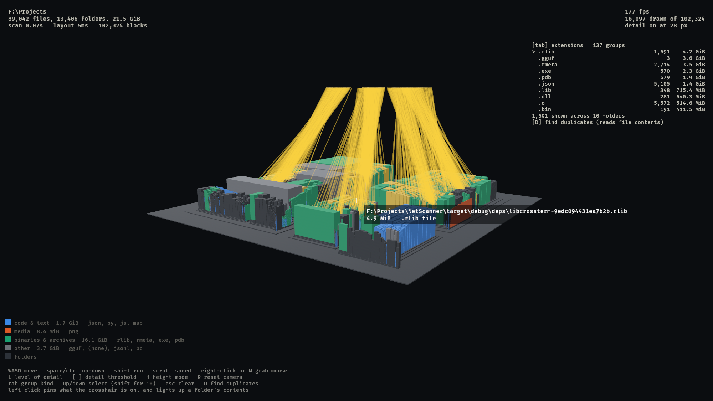

# Traveler

A 3D explorer for spaces that are too big to list. Point it at a folder and fly
through the tree; point it at a running program and fly through its address
space. Same renderer, same controls, two subjects. Rust and Bevy 0.19.


*89k files as 102k blocks. Green districts are build output, blue is source, the
crosshair names whatever it is on.*

## The crates

| | | |
|---|---|---|
| **traveler-core** | The vocabulary both subjects share: `NodeId`, and a `Tree` of parents-before-children with contiguous children. | library |
| **traveler-scan** | Parallel walk into an immutable `FileIndex`. Struct-of-arrays, full paths reconstructed on demand rather than stored. | `traveler-scan <path>` |
| **traveler-proc** | Stops a process, reads its mappings and page state, and builds the same kind of tree out of them. ptrace on Linux, `VirtualQueryEx` on Windows. | `traveler-proc --run <cmd>` |
| **traveler-sym** | ELF sections, `.dynsym` names, and DWARF lines and typed globals, so an address can be given a name. | library |
| **traveler-layout** | Squarified treemap for the disk city, address-ordered strip treemap for the address space, both extruded. Depends on `glam`, not Bevy, so it tests headlessly. | `traveler-layout <path> --svg out.svg` |
| **traveler-edges** | Groups files by extension, by name family, and by exact content. | `traveler-edges <path>` |
| **traveler-app** | The Bevy app: free camera, level of detail, picking, and everything below. | `traveler <path>` |
| **spike** | Phase 0 perf harness, kept as a regression check. | `traveler-spike --count 1_000_000` |

## How it works

```
scan          ->  FileIndex   \
capture       ->  Frame       /  impl Tree      ids, sizes, structure
Tree          ->  Layout  ->  Placements        pos, scale, visible, per node id
Placements    ->  renderer                      instanced boxes, one shared mesh
```

Everything downstream of `Tree` is written once. The detail pass, the picking,
the pin, the crosshair and the height channel do not know whether they are
looking at a drive or at a process, which is why the second subject cost a trait
and a layout rather than a second application.

Layout is a pure function, and node ids are stable across layouts, so changing a
parameter is one call plus a pass over the transforms. The workspace enforces
that boundary: `traveler-layout` cannot see Bevy, so it cannot cheat.

**Bytes are footprint area, not height.** Nested treemaps need additive weights,
and `sum(s^k) != (sum s)^k`, so "volume proportional to bytes" cannot nest.
Elevation carries nesting instead: a node's base sits at `depth * level_step`, so
a folder is a slab and its children rest on its top surface. The tree reads as
terraces from across the city, and thickness is left free for `log(size)` on disk
and for resident fraction in a process.

**Level of detail is what makes a drive tractable.** A node whose footprint
covers fewer than `--lod-px` pixels does not get its children walked, so the
folder draws as one block spanning everything inside it. Cost tracks what is
drawn, not what was scanned. Picking rides in the same traversal: the visible set
is already bounded, so testing a ray against all of it is exact and costs
nothing, with no spatial index.

**Colour is a category, not an extension.** A treemap is an all-pairs form, so
every *pair* of colours has to separate, not just legend neighbours. Validating
Okabe-Ito, Tol bright, and lightness-snapped variants against the dark surface,
no fourth hue clears both the colourblind and normal-vision floors. So there are
three plus a neutral: code, media, binaries, other. The crosshair names the exact
extension, which is what you actually wanted.



*Selecting a group lifts it out of the city. Members clump by folder, so the
shape is the answer: 1,691 `.rlib` files land in three tight columns because they
come from ten folders. `.exe` scatters across 257.*

## Inside a process

`--run` starts a program under trace, `--attach` takes one that is already
running. Either way the process is stopped, its address space is read, and it is
resumed; the stop is under two milliseconds on the targets measured below, and
nothing is parsed inside it.

What you get is the same city with a different meaning for every channel:

- **The tree is process -> region -> mapping -> section.** A region is what the
  allocator handed out: `AllocationBase` on Windows, and on Linux the adjacent
  run of mappings that share a backing, since Linux does not record it.
- **Tiles are laid in address order**, left to right and top to bottom, so the
  picture reads like a memory map rather than like a size ranking. That costs
  aspect ratio, which is measured below rather than assumed.
- **Hue is permission**: executable, writable, read-only, and reserved. Those are
  the same three validated hues plus the neutral, reused rather than replaced.
- **Thickness is resident fraction**, so four gigabytes reserved and forty
  megabytes touched reads as a wide flat plate instead of a tower. `H` switches
  it off when you want area to be the only size channel.
- **Fly close to a mapping and its pages appear** — one block per 4 KiB, in
  address order, resident pages in the mapping's colour, absent and swapped ones
  in the neutral, and anything written since the process started standing taller.
  They come from a pool sized by what the detail pass already reached, so a
  gigabyte mapping is not a million entities.
- **`C` takes another capture, `,` and `.` step between them, `X` diffs the last
  two.** The diff is a recolour of one layout, not a second one: both captures
  render into a frame built over the union of their boundaries, so a mapping that
  grew is the same tile in both. In diff mode the categorical palette is switched
  off entirely and a diverging ramp takes the three slots.
- **Names come in tiers, and the HUD says which one you are on.** Tier 1 is
  mappings and page state and never fails. Tier 2 parses the image on disk for
  sections and `.dynsym`, which is what lets the crosshair say `__gmpz_powm
  +0x290` with no debug information on the machine. Tier 3 adds DWARF: the line
  of source, and globals with a type wide enough to write.
- **`G` scans the resident set for pointers** and draws where they go, on a
  worker thread. Only resident pages are read — faulting in an absent page would
  change the working set of the thing being measured.
- **`P` writes bytes** at whatever is pinned, typed by DWARF when DWARF knows.
  **`B` sets a breakpoint** there and **`N`** runs to it and shows the stack.

A capture observes; it does not decide whether the target runs. The stop lasts
exactly as long as the read.

## Running it

Stable Rust and a Vulkan, DX12, or Metal GPU. No assets to fetch.

```bash
cargo run --release -p traveler-app
```

With no arguments that opens a launcher: Tab picks between a folder, a program to
run, and a pid to attach to. The flags skip it.

```bash
cargo run --release -p traveler-app -- --scan ~/projects
```

```bash
cargo run --release -p traveler-app -- --run /usr/bin/gdb --batch -ex "shell sleep 30"
```

`--run` takes the rest of the line, so every other option goes before it.
`--attach <pid>` needs the target to be a descendant, or
`/proc/sys/kernel/yama/ptrace_scope` at 0; launching needs no privileges at all.
`--no-aslr` launches with `ADDR_NO_RANDOMIZE` so two runs are comparable.

Debug builds are usable: dependencies compile at `opt-level = 3` and this
workspace at 1, which keeps Bevy from crawling.

`--world N` sets the city's side length, `--spacing N` scales streets and walls,
`--uniform` drops the `log(size)` thickness, `--lod-px N` moves the detail
threshold, `--no-lod` and `--no-vsync` do what they say. `--shot <file>` renders a
few seconds and saves a png, which is how the images above were taken.

WASD to move, space and ctrl for up and down, shift to run, scroll for speed,
right-click or `M` to grab the mouse. Left click pins what the crosshair is on,
esc lets go. `L` toggles detail, `[` and `]` move its threshold, `H` switches
height mode, `R` resets the camera.

In a folder: pinning a folder paints its whole subtree, Tab cycles group kind,
arrows move the selection, `D` starts the duplicate scan on a worker thread.

In a process: `C` `,` `.` `X` for captures and the diff, `G` for pointers, `P`
to write, `B` and `N` for breakpoints. The controls are on screen, so this list
is a reminder rather than something to memorise.

## Numbers

Disk figures are a TITAN Xp with vsync off and a 7200 rpm spindle for `F:`.
Process figures are Linux 7.0 with `ptrace_scope` 1, and everything measured in
this repo is Linux.

- **Scan.** 1.26M entries/sec warm. Cold cache is 220x slower and dominates
  everything; nothing in user space fixes that.
- **Layout.** 227k nodes in 15 ms, median tile aspect 1.03.
- **Render.** 95k blocks at 364 fps with detail on, 172 with it off. `C:\Windows`
  at 227k blocks holds 93-125 fps. The spike puts the ceiling far above that: 1M
  plain boxes at 38 fps in overview, falling off a cliff between 2M and 4M.
- **Edges.** Extensions and name families cost 11 ms together. Duplicates are
  seek-bound at 154 files/sec, so they run on a worker thread; on this repo's own
  tree they found 1.3 GiB of redundant build output.
- **Stop.** `python3` holding a 1 GiB `bytearray`, 44 mappings: 0.39-0.58 ms
  without page state. With eight more threads spinning, 0.38-0.63 ms — seizing
  every thread costs nothing next to reading `maps`.
- **Page state.** 13k pages cost 4.5 ms, 262k cost 15-36 ms. The spread on one
  target is transparent huge pages: 2 MiB of address space can be one page-table
  entry to walk or 512. That measurement set the caps, which are counted in pages
  rather than bytes, because pages are what the read costs.
- **Strips.** Median aspect 2.02 on `gdb` at the mapping level, 2.73 on
  `python3`, 3.54 on `node`; 2.22 on `gdb` one level deeper with sections. The
  city reaches 1.03 because a folder holds hundreds of files of similar size. A
  region holds four mappings whose sizes differ by three orders of magnitude, and
  no area-proportional layout of those produces squares.
- **Pointers.** 2.56M words in 73 ms, 266,924 candidates. A random aligned word
  landing inside a mapped extent has a 0.38-per-million chance in a 47-bit sparse
  address space, so that is 274,000x above chance. It is the only honest
  precision statement available without ground truth.

The scan is byte-exact against PowerShell, which is the check that caught the bug
the scanner exists for: `Metadata::is_dir()` returns false for a directory
junction, because std calls every reparse point a symlink, so 1,189 junctions
were filed as zero-byte files. pnpm builds `node_modules` out of junctions, so
any repo tree hits it.

141 tests, all headless. The process ones launch a fixture with a known set of
mappings and assert exact answers, so "something came back" cannot pass:

```bash
cargo test --workspace
```

## Limits

- Sizes are logical length, not size on disk, and hardlinks count once per link.
- Leaves get a weight floor of `max(bytes, 4096)`, so area is proportional to
  that rather than to raw bytes. `min_leaf_weight: 0.0` restores exact bytes.
- Slivers get culled, not hidden. 0.2% to 0.7% of tiles are still hairlines, the
  same artifact WinDirStat has. Distorting areas to hide it would break the one
  property the view rests on.
- Highlighting caps at 20,000 blocks. Counting does not, so the readout stays
  honest when the highlight is showing part of it.
- **The Windows backend is written and cross-compiled, but has never executed a
  Windows syscall.** `cargo check --target x86_64-pc-windows-msvc` is what proves
  the abstraction holds; runtime correctness needs a Windows machine.
- Page state is priced by mapped address space, not by how much is resident, so
  it is capped per mapping and per capture, smallest first. What was skipped is
  reported per node rather than drawn as an empty plate.
- A 2 MiB huge page is invisible as such: pagemap answers per 4 KiB page and says
  nothing about the size of the entry that backed it.
- Backtraces walk frame pointers, which Rust omits, so a stack can end early. It
  never invents a frame. `.eh_frame` unwinding is the real answer and is unwritten.
- No PDB, no watchpoints, and DWARF locals need a frame base that is not built
  yet. Globals and line numbers work.
- Anti-debug targets behave differently under trace, which is unavoidable, so the
  HUD says "observed under trace" rather than pretending otherwise.

## Docs

[PLAN.md](PLAN.md) and [PLAN-DYNAMIC.md](PLAN-DYNAMIC.md) are the working record:
what each phase set out to do, what it measured, and what did not survive
contact. The full graph view is the notable casualty of the first, planned
through phase 5 and dropped once it turned out that "switching views is free"
holds for the renderer but not for the detail pass. The second has its own list,
kept in the same table as the work that landed: the attach mechanism the plan
sketched cannot exist, the page cost model was optimistic by five times, and the
first strip heuristic was unusable at median aspect 6.61.

## License

Apache 2.0. See [LICENSE](LICENSE).
