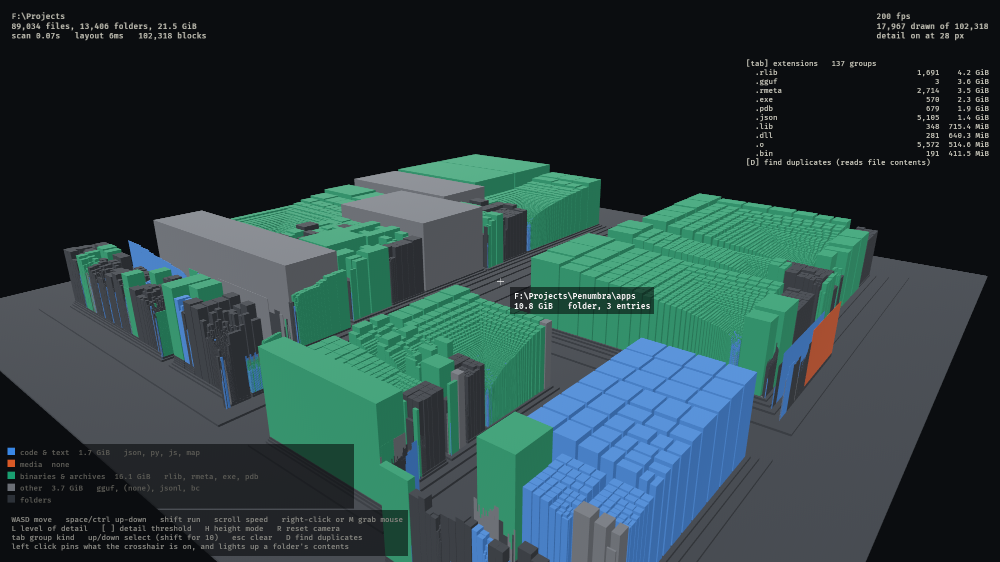

# Traveler

A 3D file-space explorer. Point it at a folder or a drive and fly through it:
footprint area is bytes, elevation is nesting depth, colour is what kind of file
it is. Rust and Bevy 0.19.



*89k files as 102k blocks. Green districts are build output, blue is source, the
crosshair names whatever it is on.*

## The crates

| | | |
|---|---|---|
| **traveler-scan** | Parallel walk into an immutable `FileIndex`. Struct-of-arrays, full paths reconstructed on demand rather than stored. | `traveler-scan <path>` |
| **traveler-layout** | Squarified treemap over the index, extruded. Depends on `glam`, not Bevy, so it tests headlessly. | `traveler-layout <path> --svg out.svg` |
| **traveler-edges** | Groups files by extension, by name family, and by exact content. | `traveler-edges <path>` |
| **traveler-app** | The Bevy app: free camera, level of detail, picking, group highlight. | `traveler <path>` |
| **spike** | Phase 0 perf harness, kept as a regression check. | `traveler-spike --count 1_000_000` |

## How it works

```
scan          ->  FileIndex                  ids, sizes, tree
FileIndex     ->  EdgeSet[]                  one per provider
Index+Edges   ->  Layout  ->  Placements     pos, scale, visible, per node id
Placements    ->  renderer                   instanced boxes, one shared mesh
```

Layout is a pure function, and node ids are stable across layouts, so changing a
parameter is one call plus a pass over the transforms. The workspace enforces
that boundary: `traveler-layout` cannot see Bevy, so it cannot cheat.

**Bytes are footprint area, not height.** Nested treemaps need additive weights,
and `sum(s^k) != (sum s)^k`, so "volume proportional to bytes" cannot nest.
Elevation carries nesting instead: a node's base sits at `depth * level_step`, so
a folder is a slab and its children rest on its top surface. The tree reads as
terraces from across the city, and thickness is left free for `log(size)`.

**Level of detail is what makes a drive tractable.** A node whose footprint
covers fewer than `--lod-px` pixels does not get its children walked, so the
folder draws as one block spanning everything inside it. Cost tracks what is
drawn, not what was scanned. Picking rides in the same traversal: the visible set
is already bounded, so testing a ray against all of it is exact and costs
nothing, with no spatial index.

**Colour is a category, not an extension.** A treemap is an all-pairs form, so
every *pair* of colours has to separate, not just legend neighbours. Validating
Okabe-Ito, Tol bright, and lightness-snapped variants against the dark surface,
no fourth hue clears both the colourblind and normal-vision floors. So there are
three plus a neutral: code, media, binaries, other. The crosshair names the exact
extension, which is what you actually wanted.


*Selecting a group lifts it out of the city. Members clump by folder, so the
shape is the answer: 1,691 `.rlib` files land in three tight columns because they
come from ten folders. `.exe` scatters across 257.*

## Running it

Stable Rust and a Vulkan, DX12, or Metal GPU. No assets to fetch.

```bash
cargo run --release -p traveler-app -- F:\Projects
```

Debug builds are usable: dependencies compile at `opt-level = 3` and this
workspace at 1, which keeps Bevy from crawling.

`--world N` sets the city's side length, `--spacing N` scales streets and walls,
`--uniform` drops the `log(size)` thickness, `--lod-px N` moves the detail
threshold, `--no-lod` and `--no-vsync` do what they say. `--shot <file>` renders a
few seconds and saves a png, which is how both images above were taken.

WASD to move, space and ctrl for up and down, shift to run, scroll for speed,
right-click to grab the mouse. Left click pins what the crosshair is on, and
pinning a folder paints its whole subtree. Tab cycles group kind, arrows move the
selection, `D` starts the duplicate scan on a worker thread, esc clears. `L`
toggles detail, `[` and `]` move its threshold, `H` switches height mode, `R`
resets the camera.

## Numbers

Measured on a TITAN Xp with vsync off, and a 7200 rpm spindle for `F:`.

- **Scan.** 1.26M entries/sec warm. Cold cache is 220x slower and dominates
  everything; nothing in user space fixes that.
- **Layout.** 227k nodes in 15 ms, median tile aspect 1.03.
- **Render.** 95k blocks at 364 fps with detail on, 172 with it off. `C:\Windows`
  at 227k blocks holds 93-125 fps. The spike puts the ceiling far above that: 1M
  plain boxes at 38 fps in overview, falling off a cliff between 2M and 4M.
- **Edges.** Extensions and name families cost 11 ms together. Duplicates are
  seek-bound at 154 files/sec, so they run on a worker thread; on this repo's own
  tree they found 1.3 GiB of redundant build output.

The scan is byte-exact against PowerShell, which is the check that caught the bug
the scanner exists for: `Metadata::is_dir()` returns false for a directory
junction, because std calls every reparse point a symlink, so 1,189 junctions
were filed as zero-byte files. pnpm builds `node_modules` out of junctions, so
any repo tree hits it.

41 tests, all headless:

```bash
cargo test -p traveler-scan -p traveler-layout -p traveler-edges
```

## Limits

- Sizes are logical length, not size on disk, and hardlinks count once per link.
- Leaves get a weight floor of `max(bytes, 4096)`, so area is proportional to
  that rather than to raw bytes. `min_leaf_weight: 0.0` restores exact bytes.
- Slivers get culled, not hidden. 0.2% to 0.7% of tiles are still hairlines, the
  same artifact WinDirStat has. Distorting areas to hide it would break the one
  property the view rests on.
- The scan blocks the window instead of streaming in, and shadows are off.
- Highlighting caps at 20,000 blocks. Counting does not, so the readout stays
  honest when the highlight is showing part of it.

## Docs

[PLAN.md](PLAN.md) is the working record: what each phase set out to do, what it
measured, and what did not survive contact. The full graph view is the notable
casualty, planned through phase 5 and dropped once it turned out that "switching
views is free" holds for the renderer but not for the detail pass, which assumes
the file tree is also a spatial hierarchy.

## License

Apache 2.0. See [LICENSE](LICENSE).
